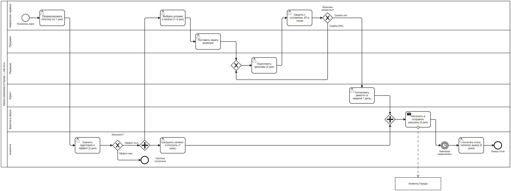

# 00. Базовая линия: процесс «как есть»

На цифры этого документа опираются все следующие разделы.

**Главный вывод: большую часть из 9 дней запуска кампания ждёт в очередях между шестью ролями.** Работы на одну кампанию у команды около 4,2 человеко-дня, а календарно кампания идёт 9 дней до запуска и ещё 5 дней на разбор. Поэтому ускорять нужно прежде всего передачи между ролями, и только потом сами операции.

Второй вывод касается денег: **коммуникации стоят в 4,8 раза дороже команды** (333 тыс. ₽ против 70 тыс. ₽ на кампанию). Если улучшить таргетинг и выбор канала на 10%, это даст 4 млн ₽ в месяц, почти половину стоимости всей команды запуска.

## Схема «как есть»

Файл для Camunda Modeler: [`diagrams/asis.bpmn`](../diagrams/asis.bpmn).

Пояснения к схеме:
- После предварительного анализа процесс расходится: аналитик выгружает сегмент и контрольную группу параллельно с цепочкой «условия → задача редакции → креативы → сверка → юрист». Обе ветки сходятся перед настройкой рассылки.
- Возврат «Ошибки (8% кампаний)» — это ошибки, найденные маркетологом при сверке. Кампания уходит обратно в редакцию.
- Ошибки, замеченные после запуска (1,5%), на схеме не показаны: их находят уже клиенты.

## Критический путь: как получаются 9 дней

Если сегмент (1 день) идёт параллельно с подготовкой предложения, критический путь такой:

| Шаг | Роль | Дни на критическом пути |
| --- | --- | --- |
| 2. Предварительный анализ | Аналитик | 2 |
| 4. Условия и каналы, задача редакции | Маркетолог, проджект | 1 (до 2) |
| 5. Креативы | Редакция | 2 |
| 6. Сверка и согласование с юристом | Маркетолог, юрист | 1 |
| 7. Настройка и отправка | Верстка и запуск | 3 |
| **Итого до запуска** | | **9 (до 10)** |
| 3. Сегмент и контроль | Аналитик | вне пути, параллельно шагам 4–6 |
| 1. Гипотеза | Маркетолог | до старта отсчёта, от 1 дня |
| Разбор итогов | Аналитик | 5 после окончания кампании |

Так сходятся заявленные 9 дней (допущение A3). Полный цикл «идея → вывод» = гипотеза (от 1 дня) + 9 дней + время работы кампании + 5 дней.

## Сколько работы на самом деле

Расчёт исходит из 21 рабочего дня в месяце (A7) и того, что вся команда занята только кампаниями (A8). Поэтому он даёт верхнюю границу усилий на кампанию: в реальности часть времени уходит на другую работу, и разрыв со сроком ещё больше.

| Роль | FTE | Человеко-дней в месяц | Человеко-дней на кампанию | Календарных дней роли в кампании | Доля работы в сроке |
| --- | --- | --- | --- | --- | --- |
| Маркетологи | 14 | 294 | 2,45 | ~3–4 (шаги 1, 4, 6) | ≤ 70% |
| Аналитики | 6 | 126 | 1,05 | 8 (шаги 2, 3, разбор) | ≤ 13% |
| Редакторы | 4 | 84 | 0,70 | 2 (шаг 5) | ≤ 35% |
| **Итого** | **24** | **504** | **4,2** | | |

Аналитик — самое узкое место по ожиданию. Восемь календарных дней его этапов содержат примерно один человеко-день работы. Остальное время кампания ждёт в очереди среди 120 других.

## Деньги на кампанию

| Статья | В месяц | На кампанию | Доля |
| --- | --- | --- | --- |
| Команда запуска (24 FTE × 0,35 млн ₽) | 8,4 млн ₽ | 70 тыс. ₽ | 17% |
| Коммуникации | 40 млн ₽ | 333 тыс. ₽ | 83% |
| **Итого** | **48,4 млн ₽** | **403 тыс. ₽** | |

Вне этих 8,4 млн ₽ остаются: 2 проджекта (0,7 млн ₽ в месяц), юрист, верстальщики и запускаторы (A1, A2).

## Ошибки

| Показатель | Доля | Кампаний в месяц | В год |
| --- | --- | --- | --- |
| Ошибка найдена до запуска (возврат в редакцию) | 8% | 9,6 | ~115 |
| Ошибка ушла клиентам | 1,5% | 1,8 | ~22 |

Возврат добавляет 2–3 дня (повторные креативы и сверка). В среднем по всем кампаниям это всего +0,24 дня к сроку, так что срок задают очереди. Главный риск для бренда в другом: ~22 ошибки в год доходят до клиентов. Эта цифра становится базовой линией для судьи.

## Контактная политика и бюджет

| Ограничение | Расчёт | Что значит |
| --- | --- | --- |
| Нагрузка на окно контактов | 120 кампаний ≈ 28 в неделю на 4 слота на клиента | Кампании разных сервисов конкурируют за одного клиента. Нужен общий планировщик контактов, а не правило внутри одной кампании |
| Потолок контактов по политике | 4 млн активных × 4 в неделю × 4,33 ≈ 69 млн в месяц | Для push и in-app ограничивает политика, а не бюджет |
| Потолок SMS по политике | 4 млн × 1 в неделю × 4,33 ≈ 17,3 млн SMS (~156 млн ₽) | Для SMS ограничивает бюджет 40 млн ₽, а не политика |
| Бюджет 40 млн ₽ | ≈ 4,4 млн SMS или ≈ 400 млн push | Выбор канала — главный денежный рычаг агента |
| Нагрузка на утверждение | 120 / 21 ≈ 6 кампаний в рабочий день | Столько решений об отправке в день примет человек, если утверждать всё вручную |

## Чего нет в базовой линии

- Денежная ценность «+20% заказов к контролю»: нет среднего чека и маржи (A5).
- Длительность работы самой кампании (между отправкой и разбором итогов).
- Распределение эффекта по кампаниям: какая доля кампаний не даёт значимого прироста.
