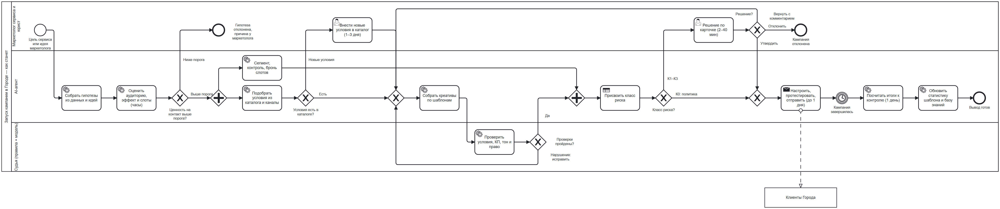

# 01. Продукт: что AI-маркетолог делает на каждом шаге

**Главный вывод: агент убирает не работу, а очереди между шестью ролями.** Шаги 1–6 агент проходит за один рабочий день, потому что ему не нужно ждать аналитика, проджекта и редакцию. После этого срок определяют решение человека об отправке и свободные слоты в контактном окне клиента. Запуск сокращается с 9 дней до ~2 на старте и ~1,5 через 6 месяцев (P1-6, доли классов из [02-autonomy.md](02-autonomy.md)). Люди перестают делать кампанию руками и начинают отвечать за то, из чего агент её собирает: условия, тон, методику, правила выпуска.

Расчёт опирается на базовую линию ([00-baseline.md](00-baseline.md), A3, A7, A8): сейчас кампания идёт 9 дней до запуска, хотя работы в ней ~4,2 человеко-дня, а аналитик занят не больше 13% календарного срока своих этапов.

## Схема «как станет»

**Человек появляется на схеме в двух местах: при вводе новых условий и при решении об отправке.** Передач между ролями больше нет.

Файл для Camunda Modeler: [`diagrams/tobe.bpmn`](../diagrams/tobe.bpmn). Для сравнения: схема [«как есть»](../diagrams/asis.png).

Что поменялось:
- Цепочка «маркетолог → проджект → редакция → маркетолог → юрист» превратилась в цикл «агент → судья → агент». Ошибку, найденную судьёй, агент исправляет сам за минуты. Раньше такая ошибка стоила 2–3 дня возврата в редакцию.
- Новые условия предложения проходят через каталог один раз: маркетолог и юрист утверждают условие, и дальше кампании с ним не требуют отдельного согласования.
- Перед отправкой агент присваивает кампании класс риска. Класс К0 выходит по заранее утверждённой политике, К1–К3 идут к человеку на карточку решения ([02-autonomy.md](02-autonomy.md)).
- Разбор итогов замыкает цикл: статистика шаблона и выводы попадают в базу знаний, на них строятся следующие гипотезы и сдвигается граница автономности.

## Что делает агент на каждом шаге

**Агент делает всю подготовку, человек задаёт рамки и принимает решение об отправке.** Рамки — это цели, каталог условий, гайд тона и методика.

| Шаг | Что делает агент | Что остаётся человеку (кто) | Срок было → станет |
| --- | --- | --- | --- |
| 1. Гипотеза | Ведёт бэклог гипотез сервиса. Принимает идеи маркетолога в свободной форме и сам предлагает гипотезы из данных: сезонность, отток, недозаказ, итоги прошлых кампаний из базы знаний. Ранжирует их по ожидаемой ценности на один контакт | Маркетолог сервиса: цели и ограничения сервиса на квартал, идеи от партнёров, выбор из бэклога | от 1 дня → минуты; выбор маркетолога вне критического пути (A3) |
| 2. Предварительный анализ | Считает размер аудитории, ожидаемый прирост по аналогам и модели отклика, стоимость по каналам, свободные слоты контактной политики. Решает «запускать / нет» по порогу ценности на контакт. Отказ агент выносит сам: он безопасен, клиент ничего не получает, а маркетолог видит причину | Аналитик: методика и модели прогноза, нестандартные случаи (новый сервис, новая механика, нет аналогов) | 2 дня → 2–3 часа |
| 3. Сегмент и контроль | Собирает выборку по шаблонам сегментов, исключает отказавшихся от рекламы, считает размер контрольной группы по мощности теста, рандомизирует. Бронирует слоты в общем планировщике контактов | Аналитик: библиотека сегментов и правила контроля, выборочная проверка | 1 день (вне пути) → минуты |
| 4. Предложение | Берёт условия только из каталога утверждённых условий и не может придумать своё. Подбирает каналы под бюджет и контактную политику. Пишет задание на креативы сам, так что передача через проджекта исчезает | Маркетолог + юрист: внести новое условие в каталог (один раз на условие). Проджект: не участвует | 1–2 дня → < 1 часа; новое условие +1–3 дня один раз (P1-2) |
| 5. Креативы | Пишет тексты push, SMS, e-mail. Баннеры и ин-аппы собирает из готовых шаблонов дизайн-системы. Готовит 2–3 варианта для теста | Редакция: гайд тона, библиотека шаблонов и эталонных текстов, новые форматы, флагманские кампании | 2 дня → 1–2 часа |
| 6. Проверка и согласование | Отдаёт кампанию судье: каждое обещание сверяется с каталогом, проверяются контактная политика, бюджет, тон, юридические формулировки. Найденное агент исправляет и проверяет заново. Затем присваивает класс риска (К0–К3) и собирает карточку решения | Человек утверждает отправку по классу: К0 — политика, утверждённая заранее; К1 — маркетолог пакетно; К2 — плюс редактор; К3 — плюс юрист. Юрист согласует шаблоны и механики, по отдельной кампании его зовут только в К3 | 1 день → минуты проверки + от 0 до 3 дней ожидания решения в зависимости от класса |
| 7. Настройка и запуск | Собирает рассылку в платформе коммуникаций через API, делает тестовую отправку на внутренние устройства, ставит в забронированные слоты. После решения отправляет и первые часы следит за доставкой, жалобами и отписками; при всплеске сам останавливает отправку | Верстка и запуск: поддержка шаблонов и интеграций, нестандартные форматы | 3 дня → ≤ 1 дня (P1-1) |
| Разбор итогов | Сразу после окна атрибуции считает прирост к контролю с доверительным интервалом и пишет вывод. Обновляет базу знаний и статистику шаблона, по которой сдвигается граница автономности | Аналитик: проверка выводов по значимым и аномальным кампаниям, ежемесячный разбор портфеля | 5 дней → 1 день (P1-4) |

Вместо цепочки 2 + 1 + 2 + 1 + 3 дня из базовой линии остаются один день работы агента и решение человека, срок которого зависит от класса риска (P1-6): К0 и К1 — 1 день до отправки, К2 — 2 дня, К3 — 3,5 дня (с внесением условий в каталог). С долями классов из [02-autonomy.md](02-autonomy.md) (P2-4) средний срок выходит ~1,9 дня на старте и ~1,5 дня через 6 месяцев против 9 дней сейчас. Полный цикл «идея → вывод» сокращается с 1 + 9 + работа кампании + 5 дней до ~1,5 + работа кампании + 1 день.

Это срок до готовности к отправке. Саму дату отправки задаёт общий планировщик контактов: если у сегмента на этой неделе уже израсходованы 4 слота, кампания уйдёт позже, иначе нарушится политика.

## Новое общее звено: планировщик контактов

**После автоматизации узким местом становится контактное окно клиента, и управлять им нужно централизованно.**

В базовой линии 120 кампаний разных сервисов дают ~28 кампаний в неделю на 4 слота на клиента ([00-baseline.md](00-baseline.md)). Сегодня конфликты между ними разрешаются вручную или не разрешаются вовсе. В новом процессе агент бронирует слоты в общем календаре контактов на шаге 3. Если кампании разных сервисов претендуют на одного клиента, побеждает кампания с большей ожидаемой ценностью на контакт. SMS отдельно ограничено 1 в неделю. Правила приоритета утверждает руководитель маркетинга Города, а не маркетологи сервисов. Ускорение подготовки не добавит кампаний на тех же клиентов, потому что контактное окно остаётся прежним. Поэтому освобождённое время команды переходит в качество кампаний и в высвобождение FTE. Тот же планировщик держит и месячный бюджет коммуникаций в 40 млн ₽ по всем сервисам: кампания, которая не помещается в остаток бюджета месяца, не получает слотов и уходит человеку.

## Как меняется работа ролей

**Каждая роль переходит от изготовления кампаний к владению тем, из чего агент их собирает.** Рутина уходит, но появляется новая работа: утверждения, каталог условий, разметка для судьи.

| Роль | Что уходит к агенту | Что остаётся и что появляется | Чем роль теперь измеряется |
| --- | --- | --- | --- |
| Маркетолог (14) | Оформление гипотез, подбор условий и каналов, вводные проджекту, сверка креативов, сбор согласований | Цели сервиса, работа с партнёрами, каталог условий, решения об отправке К1–К3, разбор отказов агента, включение К0 для своего сервиса | Прирост заказов сервиса к контролю, ошибки, ушедшие клиентам |
| Аналитик (6) | Типовой предварительный анализ, выгрузка сегментов, контроль, типовой разбор итогов | Методика и модели прогноза, правила планировщика контактов, нестандартные случаи, метрики качества агента и судьи, разбор портфеля | Точность прогноза, корректность контроля, качество выводов |
| Редакция (4) | Тексты и сборка креативов по типовым кампаниям | Гайд тона, шаблоны, эталонный набор для судьи, разметка спорных текстов, флагманские кампании, аудит выборки К0 | Доля текстов, утверждённых без правок; инциденты по тону |
| Проджект (2, вне базы, A1) | Передача вводных и задач, контроль статусов | Владелец операционной работы агента: бэклог шаблонов и интеграций, SLA утверждений | Срок до готовности, SLA решений |
| Верстка и запуск (вне базы, A2) | Типовая настройка рассылок | Шаблоны, интеграции, нестандартные форматы | Доля кампаний, настроенных без ручной работы |

Если вычесть из рутины, которую забирает агент, новую работу, получится чистое высвобождение времени по ролям на зрелости (P1-3). Это качественная оценка.

| Роль | Рутина, которую забирает агент | Новая работа | Чистое высвобождение времени |
| --- | --- | --- | --- |
| Маркетологи | ~55% | ~15% | ~40% |
| Аналитики | ~65% | ~20% | ~45% |
| Редакторы | ~60% | ~20% | ~40% |

На 24 FTE это даёт около 10 FTE, причём только на зрелости системы: на старте пилота высвобождение ниже. Доли объясняются так: у аналитика типовая работа повторяется по шаблону, поэтому рутины больше всего. У маркетолога остаются партнёры и решения, которые не автоматизируются. У редакции много новой работы: эталоны и разметка нужны судье постоянно. Не всё освобождённое время превращается в сокращение штата: какая его часть переходит в FTE, посчитано в [06-economics-pilot.md](06-economics-pilot.md).

## Допущения

| ID | Допущение | Почему так |
| --- | --- | --- |
| P1-1 | У платформы коммуникаций есть API для создания и запуска рассылок; без него шаг 7 остаётся 1–2 дня ручной настройки | Срок 3 дня на шаге 7 почти целиком ручная настройка и очередь |
| P1-2 | Каталог утверждённых условий можно собрать из действующих предложений сервисов за первый месяц пилота силами маркетологов и юриста | Без каталога агенту не на что опереться, и риск выдуманных условий не закрыть |
| P1-3 | Доли рутины, новой работы и чистого высвобождения по ролям — из таблицы выше; это оценка на зрелости (6+ месяцев) | Разложение трудозатрат базовой линии по шагам: 2,45 / 1,05 / 0,70 человеко-дня на кампанию |
| P1-4 | Разбор итогов после окна атрибуции заказов занимает 1 день; само окно входит в длительность кампании | Расчёт прироста к контролю шаблонный, ждать приходится только данных |
| P1-5 | Агент проходит шаги 1–6 за один рабочий день, включая повторную проверку после исправлений | Подготовка — это вычисления и генерация, очередей нет |
| P1-6 | Срок до отправки по классам: К0 и К1 — 1 день, К2 — 2 дня, К3 — 3,5 дня | P1-5 + SLA решения из [02-autonomy.md](02-autonomy.md) + ≤ 1 дня на настройку |
| P1-7 | Баннеры и ин-аппы агент собирает из шаблонов дизайн-системы, новые форматы рисует редакция или дизайнер | Генерация графики с нуля даёт неконтролируемый риск бренда |

## Открытые вопросы

1. Есть ли у платформы коммуникаций Города API для создания рассылок (P1-1)? Если нет, интеграция становится первой задачей пилота.
2. Кто владеет правилами приоритета в общем планировщике контактов при конфликте сервисов: руководитель маркетинга Города или комитет маркетологов?
3. Какое окно атрибуции заказов принято в Городе (P1-4)? Без него не определить длительность кампании.
4. Хватит ли у юриста времени на первичное наполнение каталога условий в первый месяц (P1-2)?
5. A1 и A2 выводят проджектов, верстальщиков и запускаторов из базы экономии, хотя в «как станет» их передаточная работа почти исчезает. Этот эффект сверх 24 FTE стоит показать отдельной строкой «вне базы», не меняя A1 и A2.
