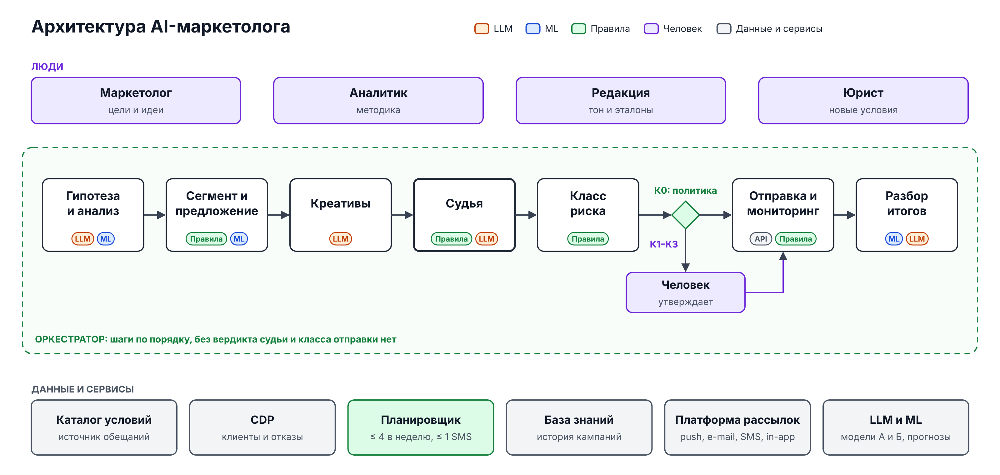

# 03. Архитектура: из чего собран AI-маркетолог

**Главный вывод: AI-маркетолог — это конвейер под управлением детерминированного оркестратора, а не одна «умная» модель.** Языковая модель пишет и разбирает текст, классическое ML считает прогнозы, а всё, что проверяется однозначно, проверяет код. У LLM нет кнопки «отправить», она не видит персональных данных и не бывает единственным рубежом для жёсткого ограничения. Поэтому её ошибка стоит одной итерации исправления и до клиента не доходит. Половина компонентов уже есть в банке (PA-1), и систему можно собрать за 6 месяцев командой из 5 человек плюс интеграционный разработчик (PA-8). Инференс стоит ~0,5 тыс. ₽ на кампанию, меньше 0,1 млн ₽ в месяц, так что почти вся стоимость системы приходится на людей.

## Схема

**Человек стоит над конвейером и задаёт сырьё (условия, тон, методику) и решение об отправке. Внизу общие сервисы и данные, которыми конвейер пользуется, но которые не может менять.**

Исходник: [`diagrams/architecture.svg`](../diagrams/architecture.svg). В верхнем ряду показаны люди и то, что они дают системе. Средний ряд — шаги кампании в порядке процесса из [01-product.md](01-product.md), цветные метки на них обозначают тип компонента. В нижних рядах лежат общие сервисы и источники данных. Логика судьи вынесена на отдельную схему [`judge.png`](../diagrams/judge.png) в [04-judge.md](04-judge.md).

## Принцип разделения: правила, ML или LLM

**Тип компонента определяется одним вопросом: можно ли проверить его результат однозначно.**

1. **Проверяется однозначно — правила (код).** Условие есть в каталоге или нет, сообщение четвёртое или пятое, бюджет превышен или нет. Правило не галлюцинирует, тестируется и объясняет отказ.
2. **Прогноз по числам — классическое ML:** отклик, прирост к контролю, выбор канала, аномалии. Модели учатся на истории, их точность измерима. LLM чисел не прогнозирует.
3. **Язык и свободный текст — LLM:** идеи маркетолога, креативы, извлечение обещаний, тон, текст вывода.
4. **LLM не единственный рубеж для жёсткого ограничения и не совершает действий с последствиями.** Отправку, бронь и запись в каталог делает оркестратор по правилу. Если LLM участвует в жёсткой проверке (извлечение обещаний), её дублирует и сверяет код.
5. **LLM не видит персональных данных.** Агент работает с сегментом («клиенты без заказа 60 дней, 180 тыс.»), имя подставляет платформа рассылок. Это снимает вопрос 152-ФЗ, но работать в контуре банка всё равно нужно, потому что условия акций составляют коммерческую тайну.

## Компоненты

**LLM — основа только в трёх местах (гипотезы, креативы, модель-судья). В остальных она в лучшем случае пишет текст поверх чисел и правил, поэтому её сбой виден и дёшев.**

| Компонент | Что делает | Тип | Почему этот тип | Если ошибётся |
| --- | --- | --- | --- | --- |
| **Оркестратор** | Ведёт кампанию по шагам как конечный автомат: состояние, повторы, лимит токенов. Инварианты: нет отправки без вердикта судьи и класса | Правила (workflow-движок банка) | Порядок и запреты должны быть воспроизводимы для аудита | Кампания зависает. Пропустить судью нельзя: инвариант проверяется ещё раз при отправке |
| **Ш1. Гипотезы** | Разбирает идеи маркетолога, ищет сигналы (отток, сезон, недозаказ), ранжирует по ценности на контакт | LLM + ML | Идеи — свободный текст; ранжирование — число | Слабая гипотеза отсекается на шаге 2, клиент её не видит |
| **Ш2. Анализ** | Аудитория (SQL по шаблону), прогноз прироста по аналогам, стоимость по каналам, «запускать / нет» | ML + правила, LLM пишет вывод | Прогноз — числовая задача с историей; порог — правило | Завышенный прогноз: условие 6 правила К0 отправит к человеку |
| **Ш3. Сегмент** | Выборка по шаблону аналитиков, исключение отказников, рандомизация контроля, бронь слотов | Правила (LLM выбирает шаблон из списка) | Состав выборки должен быть точным; свободный SQL от LLM запрещён | Не та аудитория: её ловят проверка коридора размера, баланс контроля и повторная сверка отказов |
| **Ш4. Предложение** | Условия **только** из каталога, микс каналов под бюджет и слоты, задание на креативы | Правила + ML, LLM пишет задание | Условие копируется из каталога как запись. Канал выбирается оптимизацией «прирост на рубль» | Лишние SMS: их ограничивают бюджет и класс (SMS > 100 тыс. → К2) |
| **Ш5. Креативы** | Тексты push, SMS, e-mail, in-app по шаблонам, 2–3 варианта; баннеры из дизайн-системы (P1-7) | LLM | Язык и вариативность | Выдуманное обещание, сбой тона — главная зона риска, её закрывает судья |
| **Судья** | Код, модель-судья, человек; шесть сигналов правилу классов | Правила + LLM + человек | См. [04-judge.md](04-judge.md) | Пропуск критической ошибки: независимые слои, эталоны, откат автономии |
| **Классификатор риска** | К0–К3 по самому рискованному признаку и правилу К0 из 8 условий (02) | Правила | Правило подписал человек, работать оно должно ровно так | Занижение класса = К0 без человека, поэтому тест на каждое из 8 условий |
| **Карточка решения** | Суть, отличия от шаблона, подсвеченные обещания, сигналы судьи; пакетное утверждение К1, SLA | Приложение, LLM пишет сводку | Интерфейс над данными | Сводка может исказить суть, поэтому цифры и обещания карточка берёт напрямую из данных |
| **Отправка** | Рассылка через API, тест на внутренних устройствах, слоты, волны (PA-14, [05-risks.md](05-risks.md)) | Интеграция + правила | Действие с последствиями делает только код | Дубль или чужой слот: финальная сверка с планировщиком и лимит платформы |
| **Монитор** | Доставка, жалобы, отписки, обращения, ошибки промокодов; стоп следующих волн | Правила + ML аномалий | Порог «2× медианы» — правило, базовый уровень — модель | Пропуск тревоги ограничен первой волной |
| **Разбор итогов** | Прирост к контролю с интервалом, вывод, запись в базу знаний и статистику шаблона | ML / статистика, LLM пишет вывод | Стандартный расчёт эффекта | Неверный вывод портит гипотезы; значимые кампании проверяет аналитик |
| **Движок правил** | Проверки судьи, контактная политика, бюджет, стоп-лист, класс. Правила — код с версиями и тестами | Правила | Однозначно, объяснимо | Ошибка правила повторяется везде: тесты и красная команда (04) |
| **Планировщик контактов** | Общий для всех сервисов счётчик за скользящие 7 дней, бронь, ≤ 4 сообщений и ≤ 1 SMS | Правила; приоритет — по ML-прогнозу | Жёсткое ограничение; 28 кампаний в неделю на 4 слота (00) | Нарушение политики: сверка при брони и при отправке по журналу платформы |
| **LLM-шлюз** | Модель А для агента, модель Б другого семейства для судьи; закреплённые версии, журнал, лимит токенов | Интеграция (платформа банка) | Смена вендора без переписывания, контроль версий и цены | Непроверенная версия меняет качество незаметно: шлюз её не пускает |
| **ML-модели** | Отклик и прирост, выбор канала, аномалии | ML | Числовые прогнозы на истории | Перекос прогноза ловит контроль в каждой кампании |
| **Каталог условий** | Единственный источник обещаний: параметры и лимиты, срок, оговорки, допустимые формулировки, исполнимость, кто утвердил | Данные; вносят маркетолог и юрист | Без каталога выдуманные условия не закрыть никакой моделью | Ошибка в каталоге проходит все проверки: два ключа и тестовый заказ (05, Р2) |
| **База знаний кампаний** | Брифы, сегменты, тексты, вердикты, правки людей, итоги | Данные (структурный и векторный поиск) | Память компании для аналогов и разметки | Неверные аналоги искажают прогноз; итоги пишет только разбор |
| **Гайд тона и эталоны** | Правила тона, стоп-лист, эталоны; часть эталонов скрыта от агента | Данные, владелец — редакция | Тон задают люди | Устаревший гайд — системный сбой тона; правка гайда → шаблоны в К1 (02) |
| **CDP и витрины** | Профиль, активность, согласия и отказы, заказы сервисов | Данные, только чтение | Источник истины для сегмента и эффекта | Несвежая витрина: проверка свежести перед сегментом |
| **Платформа коммуникаций** | push, e-mail, SMS, in-app: создать, тест, расписание, стоп, статистика | Интеграция (P1-1) | Существующая система банка | Нет API — шаг 7 остаётся ручным, 1–2 дня (P1-1) |
| **Журнал аудита** | Кто, что, какой версией правил и моделей сделал | Данные | Разбор инцидента и доказательство согласий | Без него нельзя откатить автономию точечно |

## Что входит в MVP пилота и что потом

**В MVP всё, что держит жёсткие ограничения, делается сразу и полностью. Упрощения касаются только эффективности: прогнозов, поиска сигналов, форматов.**

| Компонент | MVP (месяцы 1–6) | После пилота |
| --- | --- | --- |
| Гипотезы | Идеи маркетолога + 3–4 типовых сигнала (отток, недозаказ, сезон) | Поиск сигналов по всем данным сервиса |
| Прогноз и каналы | Прирост по аналогам из истории (среднее по сервису, механике и каналу) + правило выбора канала по стоимости | Uplift-модели по каналам, оптимизация микса |
| Планировщик контактов | Счётчик по журналу отправок всех сервисов + бронь; приоритет — очередь по времени брони | Приоритет по ценности на контакт между сервисами |
| Креативы | Тексты по шаблонам каналов, баннеры только из готовых шаблонов | Новые форматы под контролем редакции |
| Судья | Все три слоя полностью, эталонный набор с первого месяца | Дообучение модели-судьи на разметке, активный отбор спорных примеров |
| Каталог и карточка | Таблица в БД + формы на внутреннем конструкторе интерфейсов | Синхронизация с промо-системами сервисов и партнёров |
| Разбор итогов | Прирост к контролю, доверительный интервал, шаблонный вывод | Разбор портфеля, рекомендации следующих гипотез |

## Что берём готовым у банка

**Проект реалистичен в 6 месяцев только потому, что мы строим слой агента и судьи поверх готовой маркетинговой платформы банка.** Допущение PA-1: в банке уже есть и переиспользуются:

- CDP и витрины клиентов с реестром согласий и отказов от рекламы;
- платформа коммуникаций с API (P1-1) и, вероятно, собственным частотным лимитом по клиенту;
- внутренняя LLM-платформа с оплатой по токенам. У Т-Банка есть своя линейка моделей Gen-T; T-Pro 2.0 на 32 млрд параметров выложена в открытый доступ под Apache 2.0 ([3DNews, 18.07.2025](https://3dnews.ru/1126183/tbank-predstavil-iimodel-tpro-20-s-gibridnimi-rassugdeniyami-kotoraya-vdvoe-ekonomnee-deepseek-r1distil)). Это кандидат в модель А. Модель Б для судьи берём другого семейства (PA-2);
- ML-платформа и модели склонности, платформа A/B-тестов;
- workflow-движок, конструктор внутренних интерфейсов, дизайн-система с шаблонами баннеров, CRM поддержки.

## Стоимость системы

**Инференс почти ничего не стоит: ~0,5 тыс. ₽ на кампанию и ~0,06 млн ₽ в месяц. Стоимость системы почти целиком (~89%) — команда, поэтому вопрос о шестом человеке важнее выбора модели.**

### Инференс на кампанию: грубый расчёт

Тысячи токенов на одну кампанию, вход / выход:

| Вызовы | Вход | Выход |
| --- | --- | --- |
| Агент: 6 вызовов на шагах 1–4, карточку и разбор | 49 | 8 |
| Агент: креативы, 4 канала × 3 варианта, плюс полцикла исправлений | 60 | 12 |
| Агент: вызовы инструментов, +30% | 33 | 6 |
| Судья: извлечение обещаний, 12 текстов | 36 | 6 |
| Судья: чек-лист тона и смысла, 12 текстов × 3 прогона | 216 | 22 |
| Судья: повтор после исправлений, +50% | 126 | 14 |
| **Всего: агент 142 + 26, судья 378 + 42** | **≈ 520** | **≈ 68** |

Судья расходует в 2,5 раза больше токенов, чем агент: каждый текст он прогоняет трижды и перепроверяет после исправлений. Даже в таком объёме проверка дешевле инцидента. Всего на кампанию уходит ~0,59 млн токенов.

Цену токена берём из публичных тарифов: YandexGPT Pro 5.1 стоит 0,8 ₽ за 1000 токенов в синхронном режиме, открытые модели уровня gpt-oss-120b — 0,3 ₽, YandexGPT Pro 5 — 1,2 ₽ ([Yandex AI Studio, тарифы](https://aistudio.yandex.ru/ru/docs/ai-studio/pricing), октябрь 2026). Базовая цена 0,8 ₽ служит прокси внутренней трансфертной цены LLM-платформы банка (PA-3).

| Сценарий | Токенов на кампанию | Цена, ₽ за 1000 | ₽ на кампанию | млн ₽ в месяц на 120 кампаний |
| --- | --- | --- | --- | --- |
| Опт.: открытая модель на общей платформе, кеш контекста (−20% токенов) | 0,47 млн | 0,3 | ~150 | 0,02 |
| **База** | **0,59 млн** | **0,8** | **~470 → 500** | **0,06** |
| Конс.: режим рассуждений и длинные контексты (×2,5 токенов) | 1,47 млн | 1,2 | ~1 760 → 2 000 | 0,24 |

Регресс-прогоны судьи на эталонном наборе (04): ~500 примеров × 3 прогона × ~7 тыс. токенов ≈ 10,5 млн токенов, ~8 тыс. ₽ за прогон. При 4–12 прогонах в месяц это 0,01–0,15 млн ₽, они учтены в инфраструктуре.

### Инфраструктура, разовые затраты, команда

| Статья | Консервативный | Базовый | Оптимистичный | Из чего |
| --- | --- | --- | --- | --- |
| Инфраструктура, млн ₽/мес (PA-5) | 0,6 | 0,25 | 0,1 | Оркестратор, БД каталога и базы знаний, векторный индекс, журналы, тестовый стенд, регресс-прогоны. Модели — по токенам на платформе банка |
| Вариант «своя GPU без общей платформы», млн ₽/мес | +1,1 | — | — | Два выделенных инстанса (модель А и модель Б) по ~0,55 млн ₽ (T-Pro 2.0, конфигурация S — 756 ₽ в час, там же). Не рекомендуем: при ~70 млн токенов в месяц GPU простаивает |
| Разовые затраты, млн ₽ (PA-6) | 2,5 | 1,2 | 0,6 | База: оценка ИБ и тест на prompt-injection 0,4; первичная разметка эталонов и красная команда 0,3; юридическая экспертиза правил и стоп-листа 0,2; стенды и доступы 0,3 |
| Инференс, тыс. ₽ на кампанию (PA-4) | 2 | 0,5 | 0,15 | Расчёт выше |
| Поддержка после тиража, FTE (PA-6) | 3 | 2 | 1,5 | LLM-инженер и бэкенд-разработчик. Методолог входит в новую работу редакции (P1-3) |

**Команда пилота.** По условиям кейса в команде пять человек: продакт, LLM-инженер, бэкенд-разработчик, аналитик экспериментов (он же отвечает за ML-модели MVP, они простые) и методолог из редакции ([06-economics-pilot.md](06-economics-pilot.md)). По объёму работ пятерых не хватает.

Бэкенду нужно 27 инженеро-недель. По 4 недели уходит на оркестратор с журналом и шлюзом, на интеграцию с CDP (сегменты и отказы) и на планировщик, по 5 недель — на платформу коммуникаций, на каталог с карточкой и очередью и на монитор с ИБ и тестами. LLM-инженеру нужно 23 недели: 9 на навыки агента, 8 на судью (движок правил, извлечение, модель-судья) и 6 на стенд оценки и выбор моделей.

За 6 месяцев у одного инженера ~20 рабочих недель после адаптации, ИБ-согласований и встреч (PA-7). Бэкенду не хватает 7 недель, LLM-инженеру — 3. **Поэтому с первого месяца нужен шестой участник, интеграционный бэкенд-разработчик**, ~3,6 млн ₽ за пилот (6 × 0,6, P3-6). Он забирает платформу коммуникаций, планировщик и движок правил. Без него в пилот не помещаются планировщик контактов, главный жёсткий рубеж контактной политики, и автоматизация шага 7, от которой зависит срок запуска: 6 дней в консервативном сценарии против ~1,9 в базовом (P1-1, [06-economics-pilot.md](06-economics-pilot.md)). Пятерых хватит, только если на первой неделе подтвердится, что платформа коммуникаций уже держит частотный лимит по клиенту и имеет API, а интерфейсы собираются на внутреннем конструкторе: это снимает с бэкенда ~8 недель.

### Итог для экономической модели (база)

| | Значение |
| --- | --- |
| Команда пилота | 5 × 0,6 × 6 = 18,0 млн ₽ + шестой 3,6 млн ₽ |
| Инфраструктура за пилот | 0,25 × 6 = 1,5 млн ₽ |
| Инференс за пилот | ~115 кампаний агента (P3-13) + судья в тени на кампаниях людей ≈ 0,1 млн ₽ |
| Разовые | 1,2 млн ₽ |
| **Пилот, всего** | **≈ 24,4 млн ₽** (без шестого 20,8) |
| **Эксплуатация после тиража** | 2 × 0,6 + 0,25 + 0,06 ≈ **1,5 млн ₽/мес** (конс. 3,1, опт. 0,9) |

Из ~24 млн ₽ пилота ~89% приходится на команду, инференс занимает меньше 1%.

## Допущения

| ID | Допущение | Почему так |
| --- | --- | --- |
| PA-1 | Переиспользуются CDP с реестром отказов, платформа коммуникаций с API, LLM-платформа банка с оплатой по токенам, ML-платформа и A/B, workflow-движок, конструктор интерфейсов, дизайн-система | Без этого 6 месяцев и 5–6 человек нереалистичны |
| PA-2 | В контуре банка доступны две модели разных семейств: модель А (например, T-Pro 2.0) для агента и модель Б для судьи | Независимость судьи от агента (04) |
| PA-3 | ~0,59 млн токенов на кампанию; цена 0,8 ₽ за 1000 токенов в базе (0,3 / 1,2 в опт. и конс.) | Расчёт по вызовам выше; публичные тарифы как прокси трансфертной цены |
| PA-4 | Инференс: 2 / 0,5 / 0,15 тыс. ₽ на кампанию (конс. / база / опт.) | Расчёт выше |
| PA-5 | Инфраструктура: 0,6 / 0,25 / 0,1 млн ₽ в месяц, включая регресс-прогоны судьи | Модели по токенам на общей платформе, своя часть — сервисы и хранение |
| PA-6 | Разовые затраты: 2,5 / 1,2 / 0,6 млн ₽; поддержка: 3 / 2 / 1,5 FTE | Состав разовых затрат выше |
| PA-7 | У инженера ~20 эффективных недель за 6 месяцев пилота | Вычитаем адаптацию, ИБ-согласования, встречи, разбор инцидентов |
| PA-8 | Шестой участник — интеграционный бэкенд-разработчик с месяца 1, 3,6 млн ₽ за пилот | Бэкенд-работ 27 недель при ёмкости 20 |
| PA-9 | SMS-текст укладывается в один сегмент (70 символов кириллицей), иначе цена контакта не 9 ₽ | Проверяется слоем 1 судьи, держит цену из условий |

## Открытые вопросы

1. Есть ли у LLM-платформы банка внутренняя цена за токен, и разрешено ли маркетингу пользоваться двумя моделями разных семейств (PA-2)?
2. Держит ли платформа коммуникаций частотный лимит по клиенту сама (от этого зависит шестой человек)?
3. Какие витрины CDP содержат отказы от рекламы по каждому каналу отдельно, и как быстро в них попадает новый отказ?
